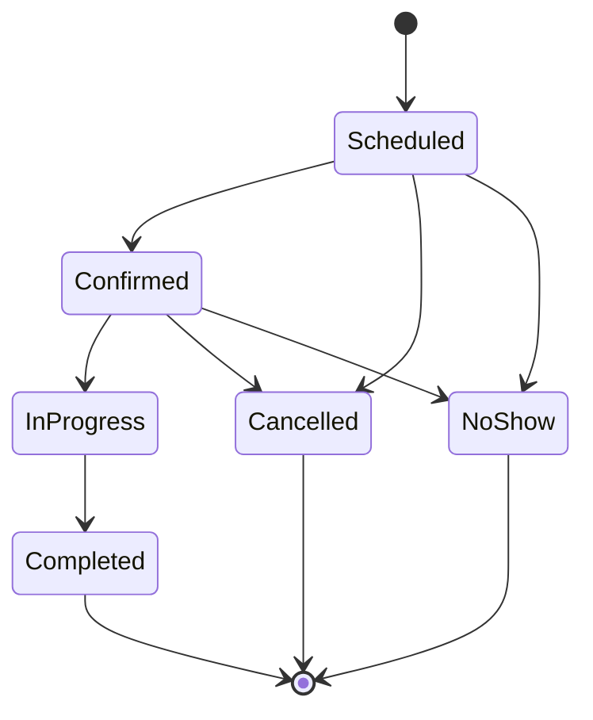

# Low-Level Design

Version: 0.7 | Updated: 27 November 2026

Status: Draft — proposed; not implemented or validated

The following is a proposed implementation design, added to make the blueprint reviewable. No database transaction or endpoint has been implemented.

## Purchase transaction

Within one database transaction, claim/check the purchase-stage idempotency key before business locks, then lock the customer and package source rows for shared reading and recheck archive/active status and reviewed package Revision. Catalog writers must lock the package exclusively before changing its scalar fields or eligibility links, so one snapshot cannot combine old price with new service/session details. Create voucher/snapshots/opening Purchase/balance/audit and committed purchase receipt together. Customer archiving uses the same customer guard, so no new purchase crosses an archive commit unnoticed. Abort every purchase write on failure; return success only after commit.

## Prepared signing summary and evidence

PUT booking usage-summary takes selectedVoucherId, bookingRevision and optional correctionTicketId. Claim its idempotent request stage first, then lock booking. Require no active deduction and either history-free initial context or matching committed reversal. Save SelectedCustomerVoucherId/PreparedCorrectionTicketId, increment UsageSummaryRevision and row Revision, clear current confirmation and mark any old unposted operation Superseded. For a matching replacement ticket, reset only its current replacement progress to AwaitingReplacement; confirmation atomically sets Pending. Old or superseded callbacks cannot overwrite a newer prepared context or a different correction ticket. No ledger or completion effect. New keys use current optimistic revision; same-key receipt replay does not increment version again.

Paper confirmation must match prepared voucher, summary version and initial/replacement route context. Under booking lock, persist immutable evidence, one uniquely linked operation, current confirmation pointer, audit and evidence receipt together. One accepted confirmation per prepared version; conflicting content requires new preparation. Completion changes row Revision but not UsageSummaryRevision. Superseded intents stay historical with no transaction and cannot post, even if a client holds an old operation ID.

## Paper-confirmation-triggered deduction

This replaces DA-06's manual redemption assumption (Candy, 2026-11-27). Both active roles confirm customer paper signature; no signature image is stored. Before confirmation, freeze reviewed customer/booking/service/voucher/one-session details and paper reference. Record staff and server confirmation time separately from optional reported paper-signing time.

Evidence and posting use two explicit boundaries. Save completion independently; when saving immutable paper confirmation, also create its stable Pending DeductionOperation in that evidence transaction, with an idempotent evidence receipt. Evidence save/supersession locks the booking and validates the current usage-summary revision, so it cannot replace signed details concurrently with posting. Completion status changes alone do not alter the frozen usage summary. Evidence response is the committed evidence fact (201 with operation ID/status URL), not a promised deduction outcome. Once both prerequisites exist, the application automatically invokes posting in the same request; no extra redemption click. Completion after confirmation uses the same stored operation. Crash/recheck recovery can invoke that use case from the Pending queue. Draft saves never confirm/complete/post.

1. Recheck authenticated active staff and authorize the single-clinic resources. Resolve immutable posting intent from the operation and paper confirmation; require a retry key for the caller action.
2. Begin posting transaction and claim/check its posting-stage receipt key before business locks. Lock booking -> selected voucher rows in stable ID order -> operation -> ticket when applicable. Resolve existing receipts before mutable validation; changed payload conflicts. Booking lock plus history/current-pointer checks serialize initial/replacement attempts across vouchers, actors and keys. Purchase/catalog and scheduling protocols use their parent guards before these child locks and never acquire them late.
3. Resolve the locked operation before mutable posting checks: if it already posted, including later reversal, return its recorded historical receipt/current operation outcome without posting again. Only for an unposted intent, revalidate Completed, current prepared UsageSummaryRevision/selection/ticket, matching current paper-confirmation pointer, frozen summary, matching customer/service/voucher, active access, voucher eligibility and at least one session. Summary changes require fresh paper confirmation and a new intent, retaining superseded evidence; do not relabel an old signature.
4. For the unposted intent, require no active booking deduction and validate initial/replacement context. Insert Redemption -1 with repeatable BookingId, unique DeductionOperationId and SignatureConfirmationId; replacement also has unique ReplacesTransactionId and ticket link. Update booking ActiveRedemptionTransactionId, balance, audit, operation Redeemed and receipt atomically; replacement also updates ticket ReplacementTransactionId/ReplacementState=Replaced. Globally unique ledger BookingId is removed: revised DA-07 permits reversed history.
5. Commit before showing deduction success. Any posting failure rolls back all posting writes, not evidence saved earlier. Then persist ReviewRequired/safe reason in a separate guarded status transaction only if no deduction committed. Do not overwrite a winning concurrent success. A crash before failure status save leaves Pending, which is recoverable.

Lost responses are OutcomeUnknown in the client: query operation outcome, then retry same intent/key. Evidence receipt means evidence saved, not deduction committed; clients use the linked current operation result to display posting success. A committed evidence retry returns that saved evidence receipt and reads the operation's current outcome. Recheck never changes signed details silently or treats a reversed intent as fresh deduction; replacement needs explicit new correction intent. No background queue infrastructure is required for this demo proposal.

## Concurrent final-session scenario

```mermaid
sequenceDiagram
    participant A as Staff A request
    participant D as PostgreSQL
    participant B as Staff B request
    A->>D: Lock voucher; read balance 1
    B->>D: Request same voucher lock; wait
    A->>D: Append -1; set balance 0; commit
    D-->>B: Lock acquired; current balance 0
    B->>D: Reject deduction; roll back
```

The winning request is determined by execution order. Use different eligible bookings and different keys for this race test; otherwise duplicate protection may hide the balance race.

## Idempotency semantics

Scope keys by authenticated actor, operation stage and key value. Hash a canonical representation of the route target and validated business payload. Do not include tokens or random transport fields. Claim the unique key first inside the action transaction, before booking/voucher locks. InProgress status/body are null; on success fill Committed receipt before the same transaction commits. InProgress claims never commit independently. Failure rolls back claim with its writes. This resolves the prior missing schema shape for a receipt claimed before the outcome exists. The successful response record and its specific action share a transaction.

Two simultaneous claims of the same key rely on a database unique constraint. On a uniqueness failure, roll back the failed transaction before reading the winner's committed record; do not continue using an aborted transaction. A bounded timeout may return a retryable conflict. Retry with the same key, not a newly generated key.

For the demo, committed keys are retained for the lifetime of the dataset. Rolled-back posting attempts do not store posting success responses. An earlier successful evidence-save receipt is retained and must not be mistaken for posting success. Record a retention policy before production. Locked booking active pointer prevents competing active deductions even with new keys; unique operation/predecessor references prevent replay of previously posted/reversed intent. Ledger BookingId is not globally unique.

## Reversal

Owner/Manager and Receptionist may both execute an Open correction ticket; no extra approval gate. Require original Redemption link and reason. Resolve immutable references, claim/check the reversal-stage key first, then lock booking -> original voucher -> original deduction operation -> ticket, reload/validate ownership and Open/unreversed state, then append +1 with unique ReversesTransactionId and ticket link. Verify booking ActiveRedemptionTransactionId matches original. Atomically restore balance, clear active pointer, mark original operation Reversed, set ticket Status=Reversed/ReplacementState=AwaitingReplacement and save audit/receipt. A unique original reversal reference blocks races across tickets. Failure leaves ticket Open with no partial reversal. Preserve original entry, paper confirmation and ticket. General Adjustment remains excluded; DEC-20261127-06 permits replacement.

## Replacement against the correct voucher

Reversal changes deduction, not the Completed booking lifecycle. Either role may use another eligible same-customer voucher after committed ticket reversal. Reversal and replacement are separate transaction outcomes: failed replacement never rolls back already-committed restoration.

1. Prepare the signing summary with the reversed correctionTicketId and correct voucher, then record fresh reviewed paper confirmation covering that persisted selection/version. Link the new operation to CorrectionTicketId/ReplacesTransactionId; retain old evidence and use new action-stage keys. Existing paper-summary binding remains a design proposal; corrected-paper wording/endorsement handling is for review, with no extra approval gate.
2. Automatically attempt posting after valid corrected confirmation. Claim/check posting-stage key, then lock booking, selected voucher, operation, ticket in the common order. Resolve any already-posted operation before mutable checks. Validate active actor, Completed state, same customer/service, new voucher differs from reversed voucher, current paper summary, eligibility and balance.
3. Require ticket Status=Reversed, matching original and committed reversal, no successor for original/ticket, and empty booking active pointer. Open/failed reversal, cancelled booking or old-event replay cannot authorize replacement. Initial posting without correction context is rejected if booking has any historical redemption.
4. Post new -1 and atomically update new balance, active pointer, operation, ticket replacement link/state, audit and receipt. Unique non-null DeductionOperationId and ReplacesTransactionId plus one replacement per ticket prevent later historical replay and races across tickets. Pointer/unreversed-ledger mismatch is a conflict for investigation, not permission to post.
5. Roll back replacement writes on failure; then save safe ReviewRequired feedback separately only if no concurrent success won. Preserve earlier reversal/restored voucher. Pre-post crash leaves Pending; retry same new intent/key. Original/reversal retries return their historical receipts.

Ticket Status stays Reversed; separate ReplacementState is NotStarted before reversal, then AwaitingReplacement/Pending/ReviewRequired/Replaced. If a posted replacement is later wrong, correct that specific new deduction through a new ticket. Prior tickets/receipts remain history; correction chain has at most one active deduction per booking.

## Appointment overlap control

Proposed baseline: serialize appointment scheduling for a staff member by locking that Staff row inside the database transaction, then check for overlapping occupied intervals before insert/update. For rescheduling between staff, lock both staff rows in stable ID order. Reload/validate the appointment after locks; use a revision check to reject stale edits. Every scheduling/status operation that can create an occupied interval follows this protocol.

Occupied statuses are Scheduled, Confirmed, InProgress and Completed; Cancelled and NoShow do not occupy time. Use `[start, end)` intervals. A PostgreSQL range exclusion constraint is an alternative stronger database guard to evaluate; it is not assumed installed. A frontend overlap check alone is insufficient.

## Appointment state model



Rescheduling changes time/staff while Scheduled or Confirmed and retains the current state. Only the listed transitions are allowed in the demo. Completion and paper-signature confirmation are separate recorded prerequisites; once both exist they automatically invoke deduction under RULE-014, superseding manual-redemption DA-06. Completion evidence can exist without a successful deduction; track AwaitingSignature/Pending/ReviewRequired/Redeemed/Reversed separately.

## Error and observability behavior

Use consistent problem responses with safe error code, status and correlation ID. Record business changes transactionally; log unsuccessful requests separately as operational events. A deadlock, lock timeout or database failure must not produce a partial success. Add bounded retry only after confirming the entire operation is safe to repeat.

## Integrity implementation and recovery contract

Use explicit transactions with a documented isolation choice; proposed baseline is Read Committed plus the row-lock protocols above and constraints in the data dictionary. Re-read protected state after locks. Plain isolation without those protocols is not the one-active-deduction guarantee. Booking pointer uniqueness alone also cannot prove there is only one unreversed historical row. All ledger writers follow the protocol; restricted database roles prevent ordinary history edits, and reconciliation detects aggregate/projection mismatch.

Parent guards precede child writes: scheduling locks target Staff IDs in stable order before booking; purchase guards customer then package before snapshot creation, and eligibility writers guard that package. Any use case needing both parent guards and booking/voucher locks acquires parents first and never calls a nested independently committing use case. Posting/reversal suffix is booking -> sorted voucher rows -> operation -> ticket. After a deadlock/timeout, roll back and retry the whole safe intent in a fresh bounded transaction with original keys; do not continue a failed transaction or replay just the final SQL statement.

Null result pointers permit insert order without an impossible FK cycle: existing booking/voucher -> evidence -> operation -> update current pointer; or existing operation/ticket -> ledger -> update result/active pointers. Set pointers, type-correct fields, state, audit and receipt before commit. Cross-row shape/current-state checks and composite FKs must agree; tests must exercise actual migrations, not mocked repositories.

GET operation reads current state; POST operation/{id}/recheck targets that exact intent. GET booking supplies the current recovery link. Historical key replay returns saved receipt; current balances are read separately. Evidence save returns its own success even if automatic posting later conflicts. A confirmed posting failure rolls back its claim/writes and records guarded ReviewRequired; it has no successful posting receipt. No automatic fallback to a different latest operation. See reviewed API contract for response fields/status semantics.

## Transaction-model review — 27 November 2026

R06 design review covers purchase snapshot/archiving guards, signing preparation/evidence, posting, reversal, replacement, operation-scoped retries, constraint coverage and recovery. It is a document/protocol review, not proof of database behavior. Planned TC-046–050 extend existing race/failure cases; all remain Not run. Migrations, exact provider mapping, SQL lock behavior and retry limits must be verified during implementation.

## Official references

- [PostgreSQL row-level locking](https://www.postgresql.org/docs/18/explicit-locking.html) — reference for locking behavior; database version still to be pinned.
- [PostgreSQL range types and exclusion constraints](https://www.postgresql.org/docs/18/rangetypes.html) — reference for the scheduling alternative.

These sources describe mechanisms. The transaction protocols above are project design proposals that require integration tests.
